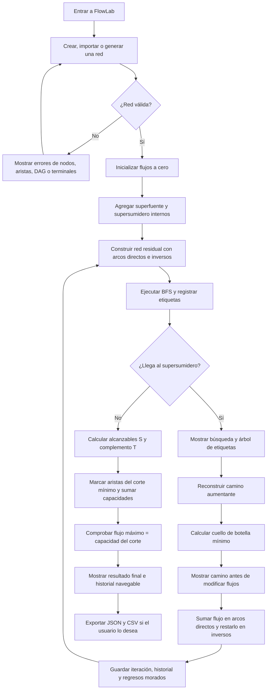

# Diagrama de flujo de FlowLab

Corresponde al motor de `src/engine/fordFulkerson.ts`, su integración en `src/App.tsx` y el procedimiento Ford–Fulkerson con etiquetado BFS.

**Estados de la interfaz por iteración:** `BUSQUEDA_BFS`, `CAMINO_ENCONTRADO`, `FLUJO_ACTUALIZADO`. El último estado es `FINAL`. Cada estado es una instantánea de flujo, residual, etiquetas y recorrido; así el usuario puede avanzar y retroceder sin alterar el resultado matemático.

**Nodos ficticios:** se crean solo en el motor para fuentes/sumideros múltiples. No forman parte de la red editable; su capacidad supera la suma de las capacidades originales para que no restrinjan el máximo.
