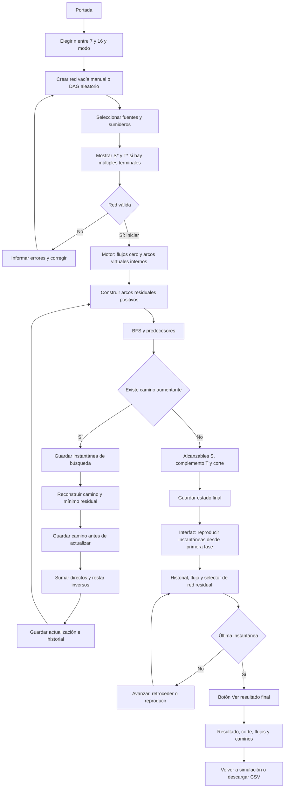

# Flujo de Flow Fulkerson 1.0

El motor calcula instantáneas al iniciar; la interfaz permite reproducirlas y retroceder. Se separa ese cálculo del recorrido visible.

Cada instantánea conserva flujo y capacidades. La red residual visible deriva c−f y f de esa instantánea; la tabla incluye ceros y el grafo solo capacidades positivas. El cálculo de capacidades de corte se contrasta con el flujo máximo en tests; el motor no delega su resolución a una biblioteca de flujo máximo.
